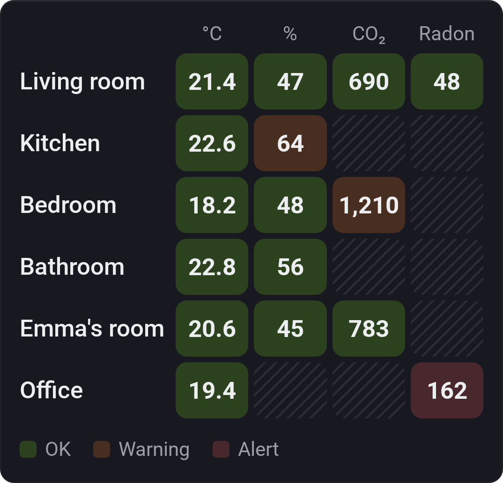

# Value Matrix

[← All widgets](../../README.md#widgets)

Any devices against any values, in one table. Pick the devices, then up to six values for the columns (temperature, humidity, CO₂, power, battery: any number a device has). The rows are the devices' Homey rooms, each cell the average of the room's devices, or the devices themselves with *Rows: Devices*. A cell is green (OK) inside the column's range, orange (Warning) outside it, and red (Alert) once it's past by half the range; it's striped where a row has no such value.

Type a column's OK range in the value's unit, such as `18–24`, `<1000` or `>10`, or `–` for none. Left empty, the values Room Health knows (temperature in °C, humidity, CO₂, radon, PM2.5, PM10, VOC in ppb) get [its ranges](roomhealth.md), and other values none. The header is the unit (°C, %) or a short name, unless you type your own.

**Settings:** devices, [rename tiles](../../README.md#tile-names), [colour style](../../README.md#colour-style), rooms or devices as rows, show legend, and per column the value, its OK range and its header.

---
[← All widgets](../../README.md#widgets)
