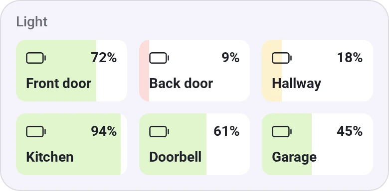
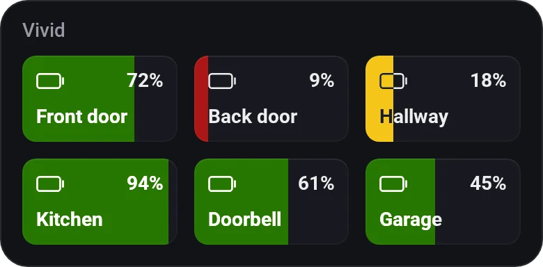
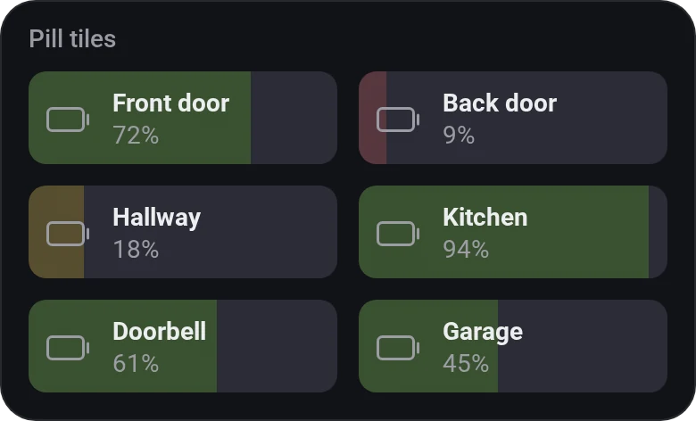
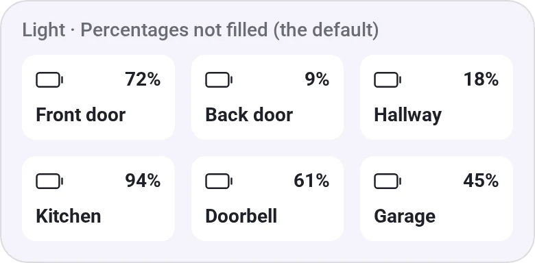

# Device Values

[← All widgets](../../README.md#widgets)

Half-height tiles that each show one live device value, optionally with a second value of the same device beside the name, such as a room's humidity next to its temperature. Percentages can fill their tile by level, and the Flow card **Set the tile colour of … to …** colours a tile, such as a fridge going red when it's too warm.

**Settings:** up to six values, each with an optional second value; 2 or 3 per row; widen the last tile (at 2 per row); compact or pill tiles (like Sensor Alarms'); percentage fill and its limits; [colour style](../../README.md#colour-style); [rename tiles](../../README.md#tile-names).

## Looks

---
[← All widgets](../../README.md#widgets)
