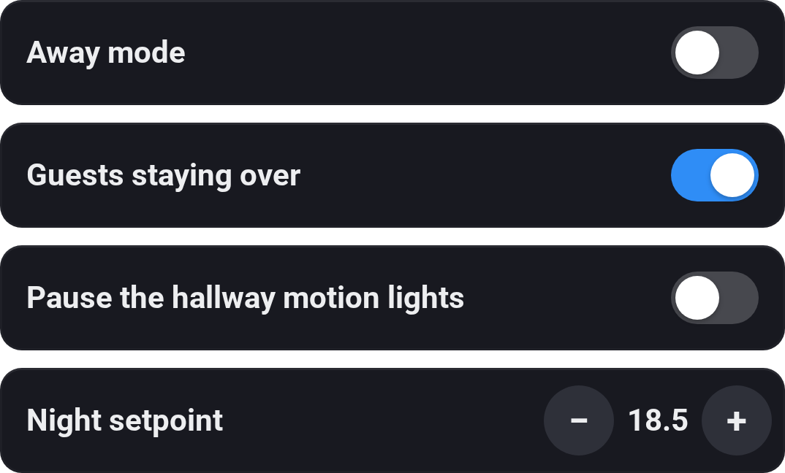
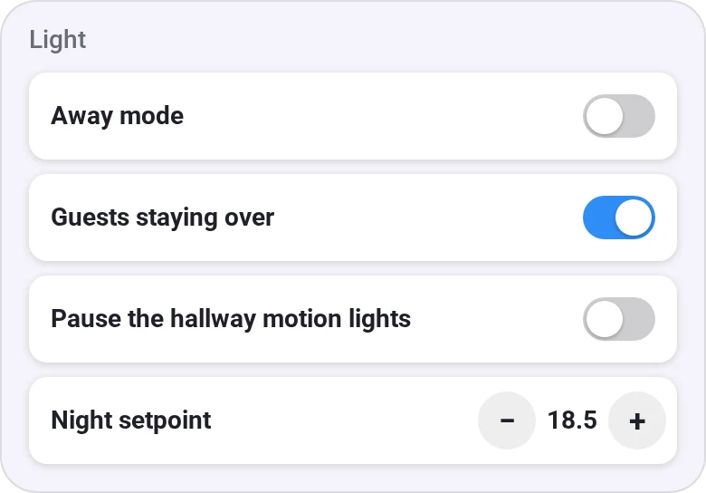
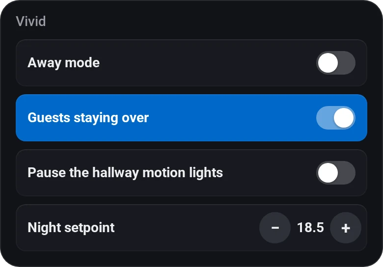
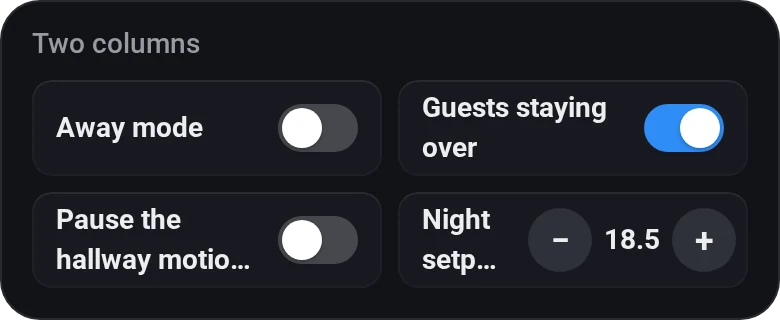
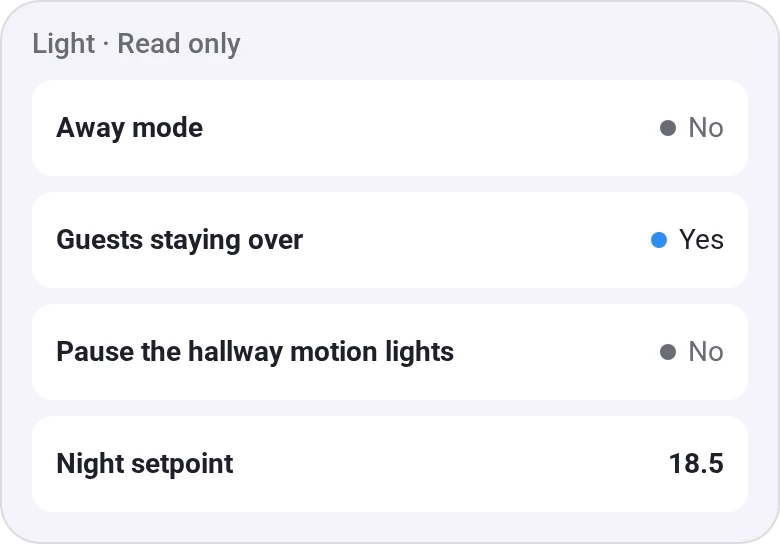

# Variables

[← All widgets](../../README.md#widgets)

Logic variables as compact rows with their full name: a switch for yes/no, − and + for a number, and the text for a string. Tap a number or text to type a value. Needs an [API key](../../README.md#api-key) with **Variables** to change them. Read only shows the values without anything to tap (a dot and Yes/No for yes/no), and needs no key.

**Settings:** up to ten variables, 1 or 2 per row, colour, [colour style](../../README.md#colour-style), read only, the − and + step, the lowest and highest number, [rename tiles](../../README.md#tile-names).

## Looks

---
[← All widgets](../../README.md#widgets)
