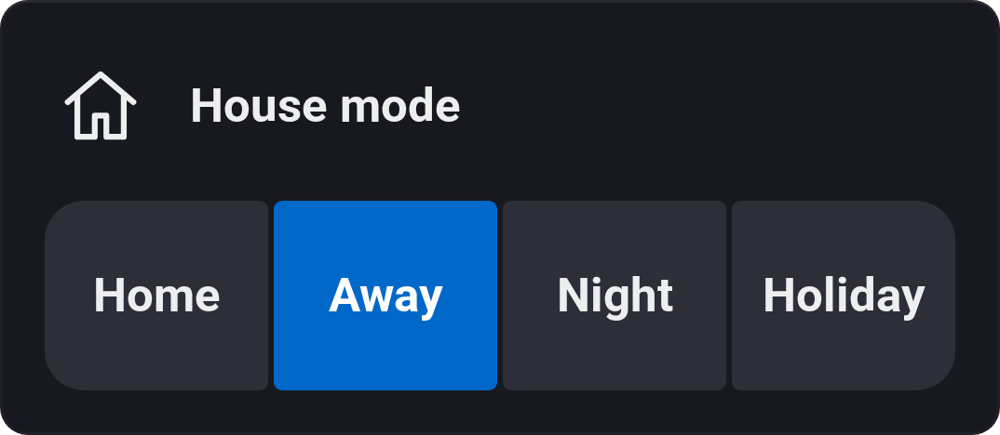
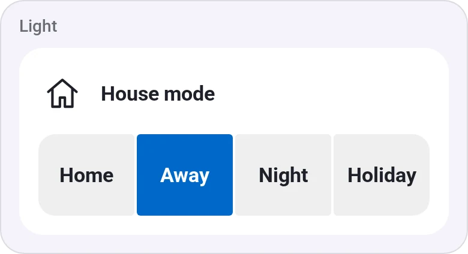
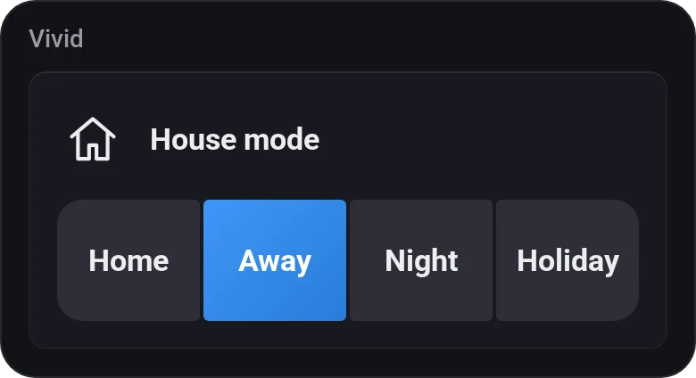
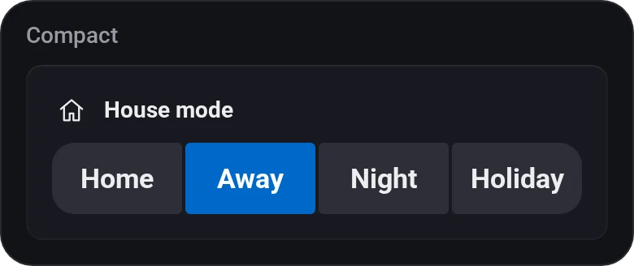
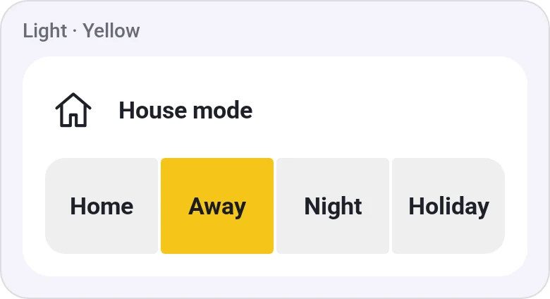
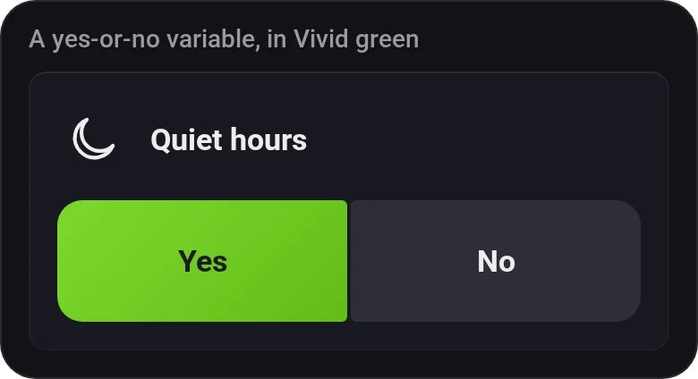

# Variable Presets

[← All widgets](../../README.md#widgets)

One Logic variable with two to four buttons, each setting it to a value you pick, such as *Home*, *Away* and *Night* for a house mode, or two setpoints. It looks like Thermostat Presets: the button matching the variable lights up in your colour, and when none does, the name shows its value. A yes/no variable without buttons set gets Yes and No. Needs an [API key](../../README.md#api-key) with **Variables** to change the variable.

**Settings:** the variable, a title instead of its name, an icon, compact layout, the button colour, [colour style](../../README.md#colour-style), and per button: the value (Yes or No, a number or a text, as the variable is; pick the variable first) and a name.

## Looks

---
[← All widgets](../../README.md#widgets)
