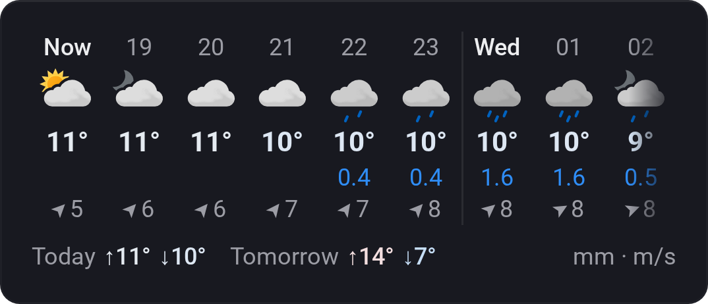

# Weather Forecast

[← All widgets](../../README.md#widgets)

The next 36 hours from [MET Norway](https://www.met.no/en) ([yr.no](https://www.yr.no)), hour by hour, with today's and tomorrow's high and low. Swipe sideways to see further ahead.

**Settings:** compact or detailed, one or two rows, 1–3 hours per column, colour style: Standard, Warm and cold (coloured temperatures) or [Vivid](../../README.md#colour-style) (the card on a gradient for the current weather).

Weather data from MET Norway, licensed under [CC BY 4.0](https://creativecommons.org/licenses/by/4.0/). Icons: [Yr's weather symbols](https://github.com/metno/weathericons) (MIT).

---
[← All widgets](../../README.md#widgets)
