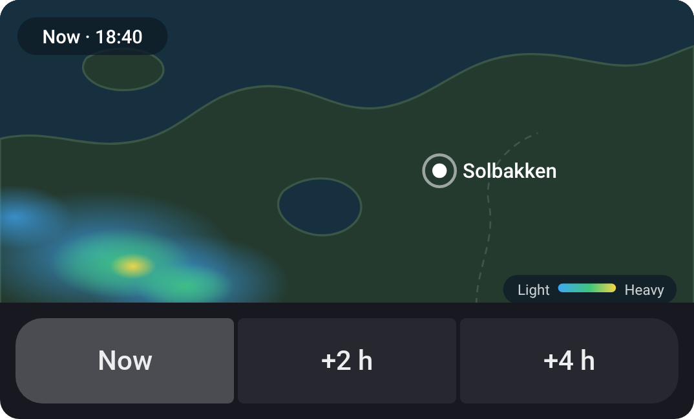
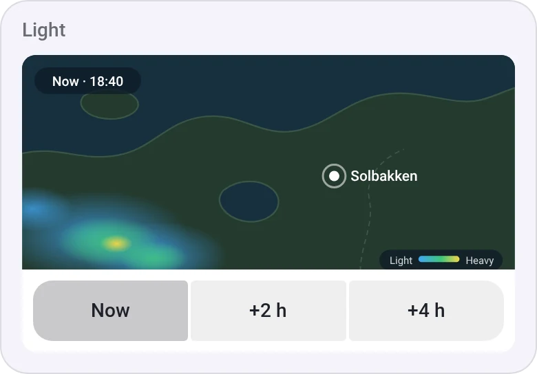
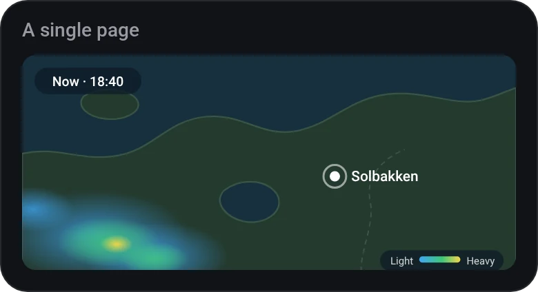

# Web Page

[← All widgets](../../README.md#widgets)

A web page you pick, drawn at the width and height you set and scaled to fill the widget without borders: set them to a fixed-size gadget's size, and it fills the widget on a phone and a tablet alike. Links on the page never open, and unless you let the page be tapped, taps are ignored and a swipe scrolls the dashboard. Two to four buttons in a row under the page switch between their addresses (for a map, the same address with another zoom on each); the widget always opens on the first. `{lat}` and `{lon}` in an address become the Homey's location. Many sites don't allow being shown inside another page (Google, YouTube and most news sites among them): the widget says so, and a site's embed or widget address often works instead. An `http://` page, such as one on your own NAS, can't be shown in a dashboard that's on `https://`, as in the Homey app on an iPhone, also at home: the widget says so. For a page on a local address, use Homey's own Web Frame widget in the app, which an iPhone allows. Otherwise give the page an `https://` address with a certificate your devices trust, or show it on a [web dashboard](../../README.md#web-dashboards) at home. You're responsible for following the terms of the site you show.

**Settings:** address, page width and height, let the page be tapped, reload every (15 minutes keeps live data current on a screen that's always on), up to four buttons (a name and an address).

## Looks

---
[← All widgets](../../README.md#widgets)
